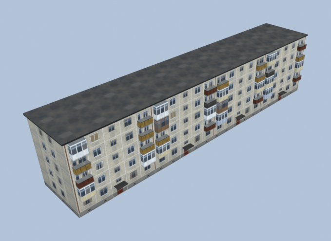
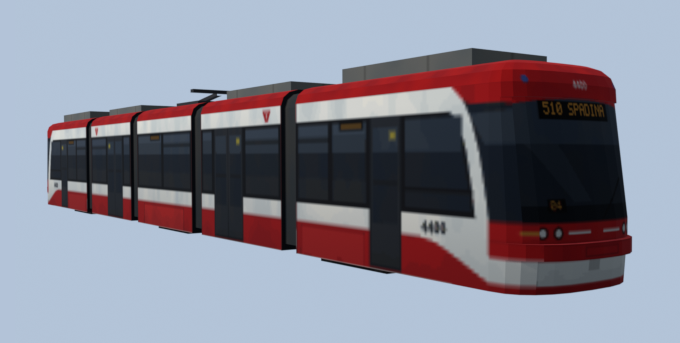
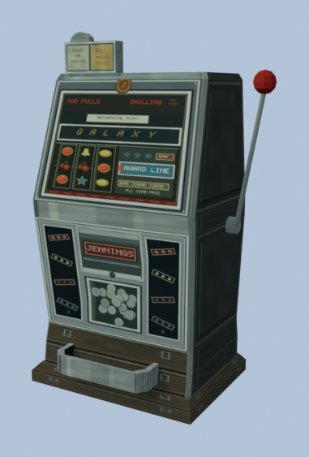

# ps2-graphics

An agent skill and Blender pipeline for building lo-poly 3D game assets in the early-PS2 look,
specifically GTA San Andreas (2004): grounded, soft, slightly faded, and built from real proportions,
not invented ones.

<table>
  <tr>
    <td align="center"></td>
    <td align="center"></td>
    <td align="center"></td>
  </tr>
  <tr>
    <td align="center"><sub>Khrushchyovka panel block · 822 tris<br>claude-opus-5.5</sub></td>
    <td align="center"><sub>TTC streetcar · 946 tris<br>claude-opus-5.5</sub></td>
    <td align="center"><sub>Mechanical slot machine · 332 tris<br>gpt-6.1-sol</sub></td>
  </tr>
</table>

Every asset above was built by an AI agent with this pipeline, and rendered with its standard
preview rig.

## What it does

- **Baked lighting, never dynamic.** One shared low sun is baked into vertex colour and multiplied
  onto the texture, so every asset is lit identically.
- **Era-correct textures.** Small power-of-two maps, painted at 4× and box-filtered down, then
  palette-quantized to 32–48 colours with no dithering. RGB only, no alpha. Shapes, metre-space
  painting, windows, masonry and correlated weathering are built in.
- **Real typefaces.** Signs and labels are set in real fonts through Blender's font engine. A 5×7
  bitmap font is reserved for genuinely digital displays.
- **Lo-poly geometry in world-space metres.** Boxes, arbitrary polygons, extrusions, lofts and
  tubes, flat-shaded, with outward winding and per-class triangle budgets.
- **Identical review renders.** The same sun, sky, 32 mm lens and 900×600 frame for every asset:
  four cardinal shots plus a 3/4 aerial, with cutaways for interiors.
- **Automated self-check.** Budgets, texture format, materials, bake range, winding, placement,
  texel density, UV stretch and saturation, plus ray probes for see-through gaps.

## Layout

```
ps2-graphics/
├── SKILL.md         the skill: workflow and hard rules for the agent
├── documentation/   style guide (+ look references), pipeline API, default project conventions
├── scripts/         the pipeline (Blender Python), copied into each project as _lib/
└── references/      subject reference material (photos, measurements)
```

## Install

OpenCode discovers skills in `~/.config/opencode/skills/`. Link this repo in so edits are live:

```sh
mkdir -p ~/.config/opencode/skills
ln -s ~/code/ps2-graphics ~/.config/opencode/skills/ps2-graphics
```

For a `/ps2-graphics` slash command, add `~/.config/opencode/commands/ps2-graphics.md`:

```md
---
description: Build or edit a PS2-era (GTA San Andreas look) 3D asset with the ps2-graphics pipeline
---

Load the `ps2-graphics` skill with the skill tool, read everything it marks mandatory, and follow it.

Task: $ARGUMENTS
```

Without the command, mention `@ps2-graphics` in a prompt, or just ask for an asset in this style:
the skill's description lets the agent pick it up on its own.

Requirements: Blender 5.2+ (bundled Python provides numpy, OpenImageIO, `blf` and `imbuf`).
Lettering uses system fonts (macOS Supplemental fonts by default) and falls back to Blender's
bundled Inter.

## Use

```
/ps2-graphics create a model of a cat
```

The agent reads the style guide and the pipeline API, then:

1. copies `scripts/` into the project as `_lib/` (once; `_lib/VERSION` records the commit), so the
   project is self-contained and rebuilds the same way later;
2. grounds the subject's real dimensions and colours, from your reference image, `references/`, or
   documented facts (any guesses are labelled as guesses);
3. writes `models/cat/` with `textures.py`, `build.py`, `render_previews.py` and `validate.py`.
   That's the default; if your repo says where models go (in `AGENTS.md`, `CLAUDE.md`, its docs, or
   the layout of existing assets), the agent uses that instead;
4. builds headless, validates, renders the previews, reviews them against the reference, and
   iterates;
5. writes `NOTES.md` (grounding, triangle count, deviations) next to `cat.blend`.

The `.blend` is self-contained: textures are packed and lighting is baked into it.

To run the scripts yourself:

```sh
B=/Applications/Blender.app/Contents/MacOS/Blender
$B -b --python models/cat/build.py
$B -b models/cat/cat.blend --python models/cat/validate.py
$B -b models/cat/cat.blend --python models/cat/render_previews.py
```

## Documentation

- [`documentation/style-preferences/style.md`](documentation/style-preferences/style.md): the style
  guide, with every MUST rule
- [`documentation/technical/lib.md`](documentation/technical/lib.md): the pipeline API
- [`documentation/project-preferences/project-structure.md`](documentation/project-preferences/project-structure.md):
  default asset layout, notes and usage tracking
- [`SKILL.md`](SKILL.md): what the agent is told to do
